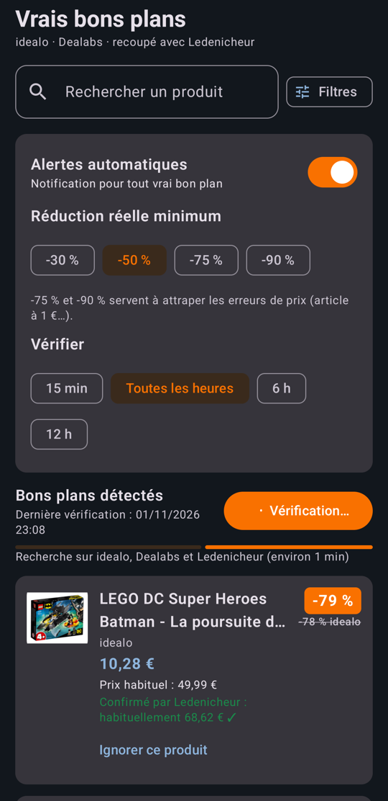

# Vrais bons plans

Application Android qui repère les **vraies** promos et les erreurs de prix, en écartant les fausses réductions.

Les comparateurs affichent souvent des « -70 % » calculés sur un prix gonflé pendant quelques semaines. L'app recalcule la réduction réelle à partir de l'historique des prix et la recoupe avec un deuxième site avant de t'alerter.

<p align="center">
  
</p>

## Fonctionnalités

- **Sources** : idealo (plus grosses baisses), Dealabs (erreurs de prix de moins de 48 h), Ledenicheur (recoupement).
- **Réduction réelle** : prix habituel = médiane des 30 derniers jours, pics et creux absurdes retirés ; une promo ne compte que si c'est un nouveau prix plancher.
- **Anti fausses promos** : au-delà de -50 %, une deuxième source doit confirmer ; sinon le produit est classé « À vérifier » sans notification.
- **Alertes automatiques** : seuil -30 / -50 / -75 / -90 %, vérification de toutes les 15 min à toutes les 12 h, bouton « Ignorer ce produit ».
- **Recherche et filtres** : prix min/max, sources, tri.

## Technique

Kotlin, Jetpack Compose, WorkManager. Aucune clé d'API : les pages sont lues via une WebView invisible.

```bash
./gradlew testDebugUnitTest   # tests unitaires
./gradlew assembleDebug       # APK de debug
```

minSdk 26 · targetSdk 36.

Sur Xiaomi / HyperOS, autoriser le **démarrage automatique** et la batterie **sans restriction**, sinon les vérifications en arrière-plan sont bloquées (l'app guide pour le faire).
