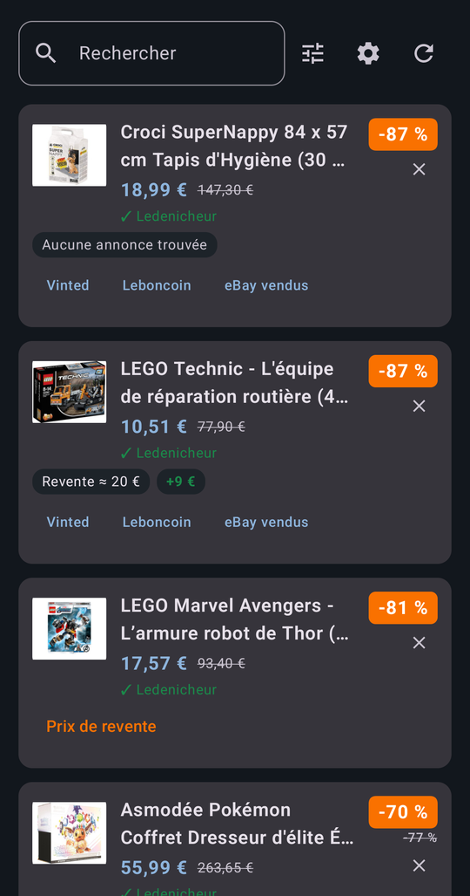
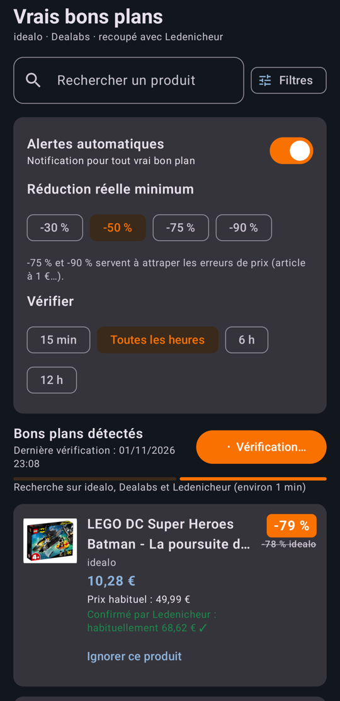
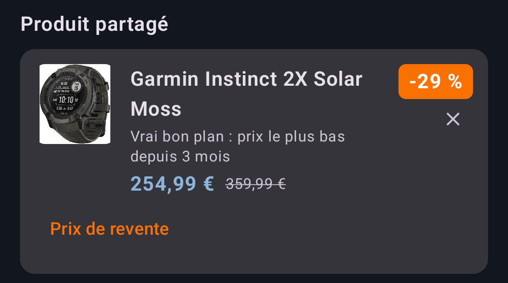

# Vrais bons plans

[](https://github.com/Floran-grmxx/VraisBonsPlans/releases/latest)

Android app that spots **genuine** deals and pricing errors, filtering out fake discounts.

Price comparison sites often show "-70%" calculated against a price that was inflated for a few weeks. The app recalculates the real discount from the price history and cross-checks it with a second site before alerting you.

<p align="center">
  
  &nbsp;
  
</p>
<p align="center">
  
</p>

## Features

- **Sources**: idealo (biggest price drops), Dealabs (pricing errors less than 48 h old), Ledenicheur (cross-checking).
- **Real discount**: usual price = median of the last 30 days, with absurd spikes and dips removed; a deal only counts if it is a new price floor.
- **Fake deal filter**: fake discounts are discarded; beyond -50%, a second source must confirm, otherwise the product is marked "To check" with no notification.
- **Resale price**: button on each deal → median price of comparable Vinted and Leboncoin listings (accessories, broken devices and other capacities excluded) and estimated profit; links to Vinted, Leboncoin and eBay sold listings.
- **Automatic alerts**: -30 / -50 / -75 / -90% threshold, checks from every 15 min to every 12 h, "Ignore this product" button.
- **Share from idealo**: "Share" a product in the idealo app → Vrais bons plans shows its real usual price, the verdict (genuine deal or fake discount) and the resale price.
- **Open in idealo**: tapping a deal opens it directly in the idealo app if installed.
- **Search and filters**: min/max price, sources, sorting.

## Download

📦 [Latest APK](https://github.com/Floran-grmxx/VraisBonsPlans/releases/latest) (Android 8.0+)

🔄 **Automatic updates** via [Obtainium](https://github.com/ImranR98/Obtainium): add the URL `https://github.com/Floran-grmxx/VraisBonsPlans` in the app — it installs the APK and offers each new release.

## Stack

Kotlin, Jetpack Compose, WorkManager. No API key: pages are read through an invisible WebView.

```bash
./gradlew testDebugUnitTest   # tests unitaires
./gradlew assembleDebug       # APK de debug
```

minSdk 26 · targetSdk 36.

On Xiaomi / HyperOS, allow **autostart** and **unrestricted** battery, otherwise background checks are blocked (the app guides you through it).
